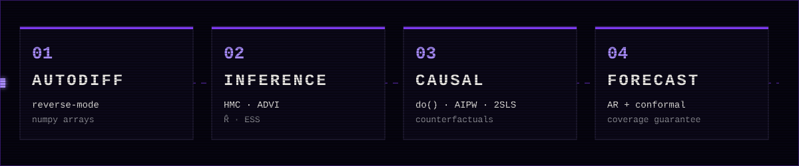
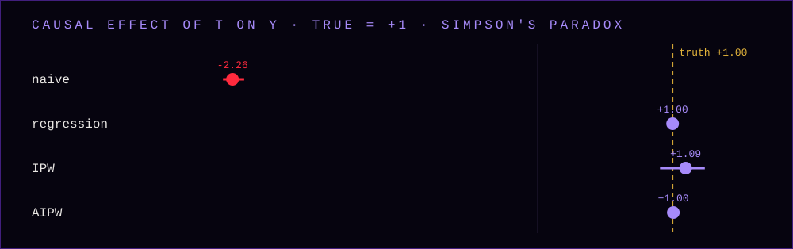
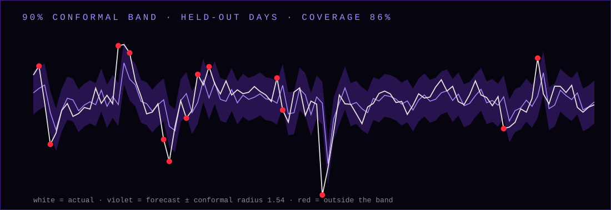

<div align="center">


</div>

**SIBYL** reasons under uncertainty. Write a log-density and get a posterior. State a causal graph and get an effect. Ask for a forecast and get an interval you can hold it to.

Everything is built from scratch in one file with one dependency: a reverse-mode **autodiff engine**, **Hamiltonian Monte Carlo** and **variational inference** on top of it, a **causal inference** toolkit, and **conformal forecasting** with a finite-sample coverage guarantee.

It quantifies uncertainty. It does not remove it.

## ▣ Run

```bash
pip install numpy
python sibyl.py --test       # 10 self-tests against analytic ground truth
python sibyl.py demo         # Bayesian + causal + forecasting report
python sibyl.py --bench
python sibyl.py charts out/
```

```python
import numpy as np, sibyl as S

# 1. Bayesian logistic regression in four lines
logp = lambda th: S.bernoulli_logit_lp(y, S.T(X) @ th) + S.normal_lp(th, 0.0, 2.5)
fit = S.hmc(logp, np.zeros(4), n_draws=1000, n_warmup=1000, n_chains=4)
fit.summary(["b0", "b1", "b2", "b3"])          # mean, sd, 90% interval, ESS, R̂

# 2. Causal effect, adjusting for confounders (doubly robust)
S.ate_aipw(t, y, confounders)

# 3. 90% forecast interval with a coverage guarantee
S.conformal_ar(series, p=2, alpha=0.1, h=5)
```

<div align="center"></div>

## ⚙ What it contains

| Module | Methods |
|---|---|
| **Autodiff** | reverse-mode on numpy arrays · broadcasting · `matmul` · indexing · `exp` `log` `tanh` `sigmoid` `softplus` · normal, Student-t, Bernoulli-logit, Poisson, exponential log-densities |
| **Inference** | **HMC** with dual-averaging step size and diagonal mass-matrix adaptation · **ADVI** (mean-field, Adam) · split-**R̂** · bulk **ESS** |
| **Causal** | structural causal models · `do()` interventions · **counterfactuals** (abduction, action, prediction) · backdoor regression · **IPW** · **AIPW** · **2SLS** instrumental variables · bootstrap intervals |
| **Forecast** | autoregressive models · **split-conformal** intervals · generic conformal regression around any model |

## ☠ Verified against ground truth



- **Autodiff** matches finite differences to **2e-8** across 12 operations.
- **HMC** reproduces the exact analytic posterior of a conjugate regression: mean error **≈ 0.001–0.01**, R̂ **1.00**, ESS in the thousands.
- **Bayesian logistic regression**: posterior mean agrees with the maximum-likelihood fit and covers the true parameters.
- **Simpson's paradox**: the naive estimate is **−2.26** (wrong sign). Regression, IPW and AIPW recover the true **+1.00**, and the `do()` simulation of the model agrees exactly.
- **Hidden confounder**: OLS says **+2.26**, 2SLS with an instrument says **+1.51**, truth **+1.50**.
- **Conformal intervals** with heavy-tailed shocks hit **90.5% / 89.8%** coverage over 400 simulated series at a 90% target.




Reproduce all of it: `python sibyl.py --test` and `python sibyl.py --bench`.

## ◉ Example output

```
① BAYESIAN LOGISTIC REGRESSION  (500 observations, HMC 4 chains)
  param            mean       sd       5%      95%     ess   rhat
  intercept      -0.604    0.110   -0.794   -0.433    2414  1.001
  x1              1.230    0.135    1.015    1.453    2533  0.999
  true      [-0.5  1.2 -0.8  0.4]
  MLE       [-0.6   1.22 -0.72  0.39]
  posterior [-0.6   1.23 -0.73  0.39]

② CAUSAL INFERENCE  (true effect = +1.00)
  naive difference              -2.256   95% CI [-2.327, -2.170]
  backdoor regression           +0.998   95% CI [+0.971, +1.033]
  doubly-robust AIPW            +1.003   95% CI [+0.969, +1.046]
  → the naive estimate has the WRONG SIGN (Simpson's paradox)
```

The banner and the social preview are drawn from **real HMC posterior draws**: the violet cloud is the actual joint posterior of a regression's intercept and slope, the dashed lines are its 1σ/2σ/3σ contours, and the gold diamond is the true parameter.

## ⚠ Honest limits

- HMC uses a fixed trajectory length with adaptation, **not NUTS**. It is exact on well-behaved posteriors; heavy funnels or strong multimodality will need reparameterisation.
- Autodiff runs in Python and numpy (≈4,000 gradients/s on a 500×4 model). It is a clear, correct reference engine, not a replacement for Stan, PyMC or JAX on large models.
- Mean-field ADVI underestimates the spread of correlated posteriors. Use HMC when the uncertainty matters.
- **Causal estimates are only as good as your assumptions**: no unmeasured confounding for regression / IPW / AIPW, a valid instrument for 2SLS. The code cannot check these for you.
- Conformal coverage is guaranteed for exchangeable calibration errors. A series that drifts or changes regime can break it.
- Research and education software. Not financial or medical advice.

## ▤ Roadmap

- [x] Autodiff, HMC, ADVI, SCM, AIPW, 2SLS, conformal AR
- [ ] NUTS sampler
- [ ] Hierarchical-model helpers and non-centred parameterisations
- [ ] Front-door adjustment and sensitivity analysis for hidden confounding
- [ ] Adaptive conformal intervals for drifting series
- [ ] PyPI release

MIT · see [LICENSE](LICENSE)
